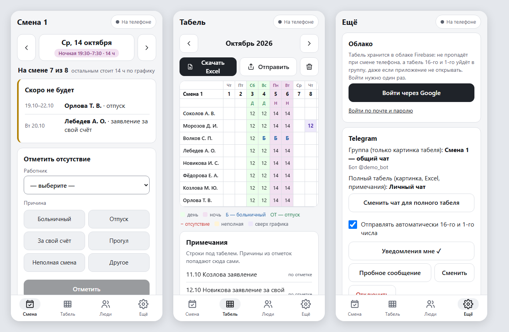
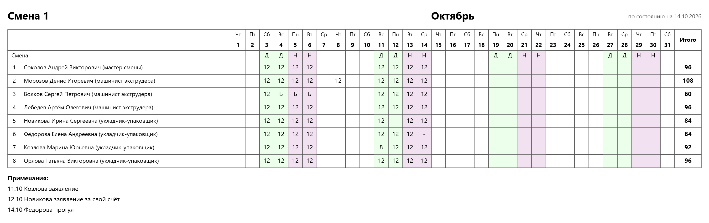

# Табель смены

Приложение для телефона, в котором мастер смены ведёт табель. Часы всем ставятся сами по графику, мастер отмечает только тех, кто не вышел. 16-го и 1-го числа готовый табель сам уходит в Telegram.

**Открыть:** https://muurd91.github.io/tabel-smeny/
Ставится на телефон как приложение: Chrome → ⋮ → «Добавить на главный экран».



*На скриншотах вымышленная смена.*

## Что умеет

- **Часы по графику — сами.** График 2/2/4: два дня по 12 ч (7:30–19:30), две ночи по 14 ч (19:30–7:30), четыре выходных. Часы появляются в табеле в сам день, будущие дни пустые.
- **Отметить, кто не вышел.** Выбираете работника и причину: больничный (Б), отпуск (ОТ), за свой счёт, прогул, неполная смена, другое. Для заявлений и отпусков можно указать даты «с … по …» заранее.
- **Табель за месяц.** Таблица как в Excel-образце, с «Итого» и примечаниями («04.09 Иванова заявление за свой счёт»). Любую клетку можно поправить или очистить.
- **Выгрузка в Excel** по образцу табеля: та же разметка, цвета дней и ночей, формулы «Итого».
- **Загрузка старого табеля из Excel.** Подтягиваются люди, отметки и примечания.
- **Работает без интернета.** Данные хранятся на телефоне и в облаке (Firebase) и сохраняются, когда появится связь.

### Что приходит в Telegram

| Когда | Куда | Что |
|---|---|---|
| 8:00 в дневную смену, 20:00 в ночную | мастеру | напоминание отметить людей + кого сегодня и на следующей смене не будет |
| сразу при отметке заявления на будущее | мастеру | «Иванова не будет 20.10 (Вт, день) — заявление за свой счёт» |
| 9:30 16-го и 1-го | мастеру | «в 11:00 табель уйдёт в группу, проверьте отметки» |
| 11:00 16-го и 1-го | в группу | картинка табеля: «Смена 1 — табель за октябрь 2026, с 01 по 16.10» |
| 11:00 16-го и 1-го | во второй чат | картинка, Excel и примечания |
| 11:00 16-го и 1-го | на почту (если настроена) | письмо: картинка, Excel и примечания |

16-го уходит табель текущего месяца по 16-е число, 1-го — итоговый за прошлый месяц.

Так выглядит картинка табеля:



## Как всё устроено

```
Телефон (приложение) ──── данные ────▶ Firebase (Firestore)
        │                                     │
        │ отметки, заявления                  │ читает табель
        ▼                                     ▼
   Бот в Telegram ◀──── отправка ──── Планировщик GitHub (по расписанию)
```

- **Приложение** — обычный сайт (HTML, CSS, JavaScript без сборки) на GitHub Pages, ставится на телефон как приложение (PWA).
- **Данные** лежат в Firebase, в базе Firestore, в документе `users/<uid>/apps/tabel`. Доступ есть только у владельца: это задают правила базы и `firebase.owner` в `js/config.js`.
- **Бот Telegram** — свой бот мастера. Токен и чаты хранятся в настройках приложения, в коде их нет.
- **Планировщик GitHub (Actions)** запускает отправку табеля и напоминания по расписанию, даже если приложение не открывали.

## Настройка с нуля

1. **Firebase** (console.firebase.google.com), бесплатный тариф Spark:
   - создать проект и добавить веб-приложение, его конфиг вписать в `js/config.js` → `firebase`;
   - Authentication → включить вход через Google, в Authorized domains добавить `muurd91.github.io`;
   - Firestore → создать базу (Standard, production mode) и вставить правила (ниже).
2. **Вход:** в приложении «Ещё» → «Войти через Google». ID аккаунта (там же) вписать в `js/config.js` → `firebase.owner` и в правила базы.
3. **Ключ для планировщика:** Firebase → настройки проекта → Service accounts → Generate new private key. Содержимое файла целиком сохранить в секрет GitHub `FIREBASE_SA` (Settings → Secrets and variables → Actions), а сам файл удалить.
4. **Бот:** создать у @BotFather, затем в приложении «Ещё» → «Подключить Telegram» → выбрать группу. Дальше «Выбрать чат для полного табеля» и «Уведомления мне» (личный чат мастера).
5. **Почта (по желанию):** завести отдельный ящик Gmail для рассылки, включить в нём двухэтапную аутентификацию и создать пароль приложения. В секреты GitHub добавить `MAIL_USER` (адрес ящика) и `MAIL_PASS` (пароль приложения), для не-Gmail ещё `MAIL_HOST`. Получателей вписать в приложении: «Ещё» → «Почта».
6. **Проверка:** Actions → «Табель в группу и на почту» → Run workflow → `test`; Actions → «Напоминания» → Run workflow → `test`.

Правила Firestore (вместо `UID` — ID аккаунта владельца):

```
rules_version = '2';
service cloud.firestore {
  match /databases/{database}/documents {
    match /users/{uid}/{document=**} {
      allow read, write: if request.auth != null && request.auth.uid == uid && uid == 'UID';
    }
  }
}
```

## Если что-то пошло не так

- **Табель 16-го или 1-го не пришёл.** Откройте Actions → «Табель в группу и на почту»: в журнале запуска написано, почему табель пропущен («уже отправлено», «бот не подключён» и т.п.). Если планировщик не сработал, приложение само дошлёт табель при открытии после 11:00. Отправить вручную: «Табель» → «Отправить».
- **Приложение показывает «Приложение не загрузилось».** Нажмите «Обновить приложение». Данные на телефоне и в облаке не пропадут.
- **Сменился бот или группа.** «Ещё» → Telegram → «Сменить». При подключении того же бота прежние чаты сохраняются.
- **Поменялся график смены.** «Ещё» → «График смены»: первый день цикла, цикл (`ДДННВВВВ`), часы. Напоминания и отправка подхватят его сами.
- **Вход в облако слетел.** «Ещё» → «Войти через Google». Отметки, сделанные без входа, сохранены на телефоне и уйдут после входа.

## Для разработки

| Файл | Что внутри |
|---|---|
| `index.html`, `css/style.css` | страница и стили |
| `js/config.js` | настройки: график по умолчанию, коды, Firebase, час отправки |
| `js/data.js` | данные, даты, график, расчёт табеля и примечаний |
| `js/cloud.js` | Firebase: вход, синхронизация, офлайн |
| `js/xlsx.js` | выгрузка и загрузка Excel (свой zip, без библиотек) |
| `js/report.js` | картинка табеля, снимки 16-го и 1-го, отправка |
| `js/telegram.js` | бот: группа, второй чат, личные уведомления |
| `js/app.js` | экраны и кнопки |
| `sw.js` | офлайн-копия приложения на телефоне |
| `remind/send.mjs`, `.github/workflows/send.yml` | отправка табеля по расписанию (Telegram и почта) |
| `remind/remind.mjs`, `.github/workflows/remind.yml` | напоминания мастеру |

- **Перед каждым коммитом, который меняет файлы приложения**, запускайте `sh tools/bump.sh`. Скрипт поднимает версию в `sw.js` и `?v=` в `index.html`, иначе телефон может получить новую страницу со старыми скриптами.
- **Локально:** любой статический сервер в папке проекта. Без https вход в облако не работает, остальное работает.
- **Проверить картинку и Excel без отправки:** Actions → «Табель в группу и на почту» → Run workflow → `selftest` (вымышленные данные, результат — в артефакте запуска).
- **Репозиторий публичный.** Реальные ФИО, табели, токены и ключи сюда не попадают: `*.xlsx` и `test/` в `.gitignore`, примеры в коде только вымышленные, журналы запусков без имён.
